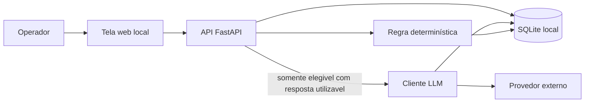

# Arquitetura compartilhada

Este documento congela forma do produto, stack, fronteiras e fluxo. Um agente que leia só este arquivo e `specs/03-contratos-compartilhados.md` sabe onde encaixa a própria etapa sem escolher stack, banco ou provedor de novo.

Decisões: ADRs 001–007. Visão: `specs/00-visao-produto.md`. Vocabulário: `specs/glossario.md`.

## Forma do produto

Aplicação web local (ADR 001). O operador inicia o backend na máquina, abre o navegador em localhost e opera a triagem. Sem autenticação.

## Módulos e responsabilidades

```
apps/web          interface (React 18 + TypeScript + Vite + React Router)
apps/api          FastAPI + Uvicorn; orquestra HTTP; não contém regra de idade/cargo misturada com LLM
      importacao  lê CSV/XLSX (pandas, openpyxl); aplica mapeamento de colunas
      triagem     regras determinísticas puras; zero HTTP externo
      avaliacao_ia  monta prompt versionado + cliente LLM; único ponto de rede para modelo
      persistencia  SQLAlchemy 2 + SQLite
```

Regras de dependência:

- `web` → `api` apenas. Nunca chama o provedor de LLM.
- `triagem` não importa `avaliacao_ia`.
- `avaliacao_ia` lê decisões já persistidas; não recalcula idade/cargo/escolaridade.
- `persistencia` não conhece SDK de fornecedor.

## Diagrama de runtime

A seta para o LLM sai **somente** depois da decisão `elegivel` com resposta de chatbot presente e utilizável.



```mermaid
sequenceDiagram
  actor Operador
  participant Tela
  participant API
  participant Triagem
  participant DB
  participant ClienteLLM
  participant Provedor

  Operador->>Tela: cria/abre projeto e configura critérios duros
  Tela->>API: gravar CriteriosDeterministicos
  API->>DB: persistir

  Operador->>Tela: importa planilha e mapeia colunas
  Tela->>API: importar
  API->>DB: gravar CandidatoImportado[]

  Operador->>Tela: executar triagem
  Tela->>API: executar triagem
  API->>Triagem: avaliar lote
  Triagem-->>API: DecisaoTriagem[]
  API->>DB: persistir decisões
  Note over ClienteLLM,Provedor: nenhuma chamada nesta etapa

  Operador->>Tela: critérios qualitativos + editar prompt
  Tela->>API: gravar versão
  API->>DB: persistir PromptDoProjeto e CriteriosQualitativos

  Operador->>Tela: executar avaliação IA
  Tela->>API: avaliar lote
  API->>DB: ler elegíveis
  alt inelegivel ou sem resposta utilizável
    API-->>Tela: sem chamada externa; inelegivel ignorado / aguardando
  else elegivel com resposta
    API->>ClienteLLM: payload mínimo (ADR 007)
    ClienteLLM->>Provedor: HTTP com timeout e retry limitado
    Provedor-->>ClienteLLM: JSON estruturado + uso de token
    ClienteLLM->>DB: AvaliacaoIa com versão do prompt
  end
  API-->>Tela: resultado por candidato
```

## Navegação da primeira entrega

| Passo | Tela / ação | Etapa dona do detalhe |
|---|---|---|
| 1 | Criar ou abrir projeto | compartilhado |
| 2 | Configurar critérios duros | agente 1 |
| 3 | Importar planilha e mapear colunas | compartilhado; contrato de último cargo ADR 006 |
| 4 | Executar triagem determinística | agente 1 |
| 5 | Critérios qualitativos + editor de prompt | agente 2 |
| 6 | Executar avaliação por LLM | agente 2 |
| 7 | Resultado por candidato | compartilhado (compõe 1 + 2) |
| — | Botão **Avaliar trajetória** | agente 3; **desabilitado**; texto: função em sprint posterior; **não dispara modelo** |

O botão de trajetória aparece no mapa. Não há endpoint ativo `avaliar_trajetoria` na primeira entrega. O contrato reserva o identificador da ação.

## Persistência

Arquivo SQLite `SCREENER_DB_PATH` (padrão `./data/screener.sqlite`). Sobrevive ao fechamento (ADR 003).

Persiste pelo menos:

- projeto
- critérios determinísticos vigentes
- critérios qualitativos vigentes
- versões de prompt
- candidatos importados do lote atual do projeto
- decisões de triagem
- avaliações de IA (com versão e tokens)
- mapeamento de colunas usado na importação

Não persiste a planilha como banco. Não usa Excel como sistema de registro.

## Importação

- Formatos: CSV e XLSX.
- Encoding: selecionável; o legado lia `latin-1` — oferecer `latin-1` e `utf-8` no mínimo.
- O operador mapeia colunas do arquivo para os campos do contrato `CandidatoImportado`.
- Colunas de resposta de chatbot **não têm nome congelado**: não havia CSV local nem leitura dessas colunas no código. Se o arquivo tiver uma ou mais colunas de texto de resposta, o operador as mapeia.
- Identificador estável `candidatoId` é gerado na importação (UUID). Índice de linha de origem é metadado de rastreio, não identidade de negócio.

## Cliente de LLM

ADR 004. Variáveis `LLM_BASE_URL`, `LLM_API_KEY`, `LLM_MODEL`, `LLM_TIMEOUT_SECONDS`, `LLM_MAX_RETRIES`.

Pseudocódigo do gate (não é código de produto):

```
para cada candidato no pedido de avaliação:
  se decisao.resultado != elegivel: nao chamar; nao enviar dado
  se nao tem resposta utilizavel: estado = aguardando; nao chamar
  senão: montar payload mínimo; chamar adaptador; validar schema;
         persistir AvaliacaoIa + tokens + promptVersionId
         se schema inválido após retries: estado = falha_avaliacao; sem perfil inventado
```

## O que cada agente de spec não escolhe de novo

| Decisão | Onde está |
|---|---|
| Web local, sem login | ADR 001 |
| React + Vite / FastAPI / SQLite | ADR 002, 003 |
| Provedor LLM por env | ADR 004 |
| Funil Excel fora da 1ª entrega | ADR 005 |
| Último cargo = coluna mapeada | ADR 006 |
| Nome fora do prompt | ADR 007 |
| Tipos entre etapas | `specs/03-contratos-compartilhados.md` |

## Critérios de aceite da arquitetura

Não são os Given/When/Then de widget da etapa 1 nem de prompt da etapa 2.

1. Dado um candidato `inelegivel`, quando a avaliação por IA é disparada, então nenhuma chamada externa é especificada como permitida.
2. Dado um candidato `elegivel` sem resposta utilizável, quando a avaliação por IA é disparada, então não há chamada externa e o estado permanece `aguardando`.
3. Dado critério ativo com configuração vazia, quando a triagem é executada, então a API recusa o lote inteiro com erro explicável (não aceita todos em silêncio).
4. Dado critério inativo, quando a triagem é executada, então esse critério não produz motivo de inelegibilidade.
5. Dado o módulo `triagem`, quando o código de etapa 1 for implementado, então ele não referencia cliente HTTP de LLM.
6. Dado o fechamento do programa, quando o operador reabre o projeto, então critérios, versões de prompt e resultados ainda existem no SQLite.
7. Dado o botão de trajetória, quando a primeira entrega é usada, então a ação está visível, desabilitada, sem request de modelo.
8. Dado `LLM_API_KEY` vazia, quando a etapa 2 é disparada, então não há chamada e a tela explica a falta de configuração.
9. Dado um payload de etapa 2, quando ele é montado, então não contém nome, idade, cargo, escolaridade, cidade, equipe nem candidatos inelegíveis (ADR 007).
10. Dado o resultado principal da operação, quando o operador consulta o projeto, então vê por candidato inelegibilidade com motivos, ou aguardando, ou perfil + compatibilidade — não o funil Excel legado.

## Fora desta arquitetura

- Treino de modelo, limiar 0,4, one-hot
- Papéis de usuário
- Implementação da etapa 3
- Relatório de funil por coluna do script antigo
