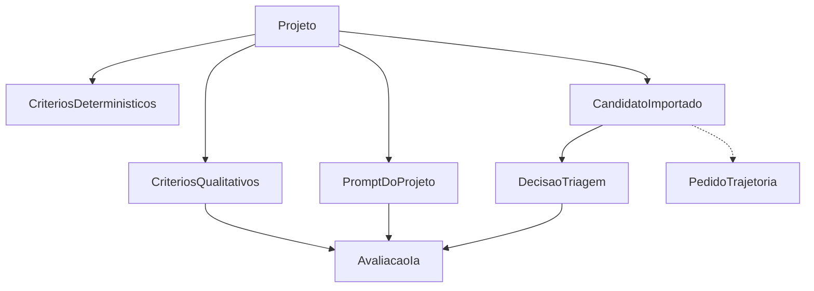

# Contratos compartilhados

Tipos conceituais entre etapas. Atributos, obrigatoriedade e dono do detalhe. Sem widget, sem texto de prompt, sem Given/When/Then de comparação fina.

Valores de exemplo são ilustrativos. Colunas de resposta de chatbot não foram observadas em CSV local nem no código vigente; por isso o contrato pede mapeamento, não um nome de coluna inventado.

## Relação entre tipos



`AvaliacaoIa` só existe quando `DecisaoTriagem.resultado = elegivel` e há resposta utilizável. `PedidoTrajetoria` não é executado na primeira entrega.

---

## `Projeto`

Uma vaga ou processo seletivo. Dono dos critérios e do prompt.

| Atributo | Obrigatório | Notas |
|---|---|---|
| `projetoId` | sim | gerado na criação |
| `nome` | sim | rótulo operacional |
| `criadoEm` / `atualizadoEm` | sim | |
| `criteriosDeterministicos` | sim | vigente; ver tipo abaixo |
| `criteriosQualitativos` | não na criação | obrigatório para disparar etapa 2 |
| `promptVigenteId` | não na criação | obrigatório para disparar etapa 2 |
| `mapeamentoColunas` | não na criação | obrigatório para importar |

Dono do detalhe de tela de projeto: compartilhado. Não inventar campos de cliente, unidade de negócio ou papéis.

Exemplo:

```json
{
  "projetoId": "prj_01",
  "nome": "Vaga exemplo",
  "promptVigenteId": "prm_03"
}
```

---

## `CriteriosDeterministicos`

Cargos aceitos, faixa de idade, escolaridade, flag ativo/inativo de cada um.

| Atributo | Obrigatório | Notas |
|---|---|---|
| `cargos.ativo` | sim | boolean |
| `cargos.aceitos` | se ativo, sim e não vazio | lista de strings; vazio + ativo = erro de execução |
| `idade.ativo` | sim | boolean |
| `idade.minima` / `idade.maxima` | se ativo, sim | faixa inclusiva; detalhe de limites abertos: agente 1 |
| `escolaridade.ativo` | sim | boolean |
| `escolaridade.configuracao` | se ativo, sim e não vazia | forma exata (lista, nível mínimo, ou os dois): **agente 1** |

Regras já fechadas (não reabrir):

- último cargo fora da lista → inelegível, se o critério de cargo estiver ativo
- idade fora da faixa → inelegível, se idade estiver ativa
- comparação de escolaridade **não** vai para o LLM
- ativo + configuração vazia impede a execução e explica o erro
- inativo não elimina ninguém
- lista vazia não significa aceitar todos em silêncio
- esta estrutura não tem score de IA

Dono do detalhe: **agente 1**.

---

## `CandidatoImportado`

Linha do mapeamento depois do mapeamento de colunas.

| Atributo | Obrigatório | Origem verificada |
|---|---|---|
| `candidatoId` | sim | gerado na importação (UUID); o legado não tem chave estável vigente |
| `projetoId` | sim | |
| `linhaOrigem` | sim | índice da linha no arquivo, metadado |
| `ultimoCargo` | sim se critério de cargo ativo | coluna mapeada; default sugerido ao operador: `Cargo` se existir (ADR 006) |
| `idade` | sim se critério de idade ativo | coluna `Idade` no legado, se mapeada; valor numérico original, **sem** `pd.cut` |
| `escolaridade` | sim se critério de escolaridade ativo | coluna `Escolaridade` no legado, se mapeada; texto original, **sem** virar `bacharelado` por raridade |
| `respostasChatbot` | não | lista de `{ colunaMapeada, texto }`; utilizável se houver pelo menos um texto não vazio — critério fino: agente 2 |
| `nomeExibicao` | não | só se o operador mapear uma coluna de nome; `Nome` **não** está confirmado no código vigente |
| `cidade` | não | coluna `Cidade` existe no legado; **não** entra no LLM (ADR 007); etapa 1 da primeira entrega não a tem como critério obrigatório |
| `statusLegado` | não | `Status` / `Status Chatbot` / `Elegível` / `Equipe` podem ser mapeados como metadado; **não** são critério duro nem payload de LLM |

Não inventar colunas. Campos opcionais acima só existem se o arquivo tiver a coluna **e** o operador mapear.

`Atualização CV` aparece só no `--dev_mode` do funil. Não é campo do contrato de triagem.

Exemplo (respostas sem nome de coluna inventado como obrigatório):

```json
{
  "candidatoId": "cand_7f3a",
  "projetoId": "prj_01",
  "linhaOrigem": 12,
  "ultimoCargo": "Analista de dados sênior",
  "idade": 34,
  "escolaridade": "Bacharelado em Estatística",
  "respostasChatbot": [
    { "colunaMapeada": "(definida na importação)", "texto": "(texto da célula)" }
  ],
  "nomeExibicao": null
}
```

---

## `DecisaoTriagem`

Resultado da etapa 1. Nenhum campo de score de IA.

| Atributo | Obrigatório | Notas |
|---|---|---|
| `candidatoId` | sim | |
| `projetoId` | sim | |
| `resultado` | sim | `elegivel` \| `inelegivel` |
| `motivos` | sim | lista; vazia se elegível; cada item cita o critério que falhou |
| `criteriosInativos` | sim | lista dos critérios que não rodaram por estarem inativos |
| `criteriosVersao` | sim | referência aos critérios usados nesta execução |

Não há `aguardando` aqui. Aguardar resposta é estado **depois** desta decisão, na composição do resultado.

Dono do detalhe: **agente 1**.

---

## `CriteriosQualitativos`

Critérios da vaga usados só na avaliação por LLM. Distintos dos duros.

| Atributo | Obrigatório | Notas |
|---|---|---|
| `projetoId` | sim | |
| `itens` | sim para disparar etapa 2 | lista estruturada (identificador + enunciado). Conteúdo: agente 2 |
| `versaoId` | sim quando gravado | |

Não copiar listas de `Status` do legado para dentro desta estrutura.

Dono do detalhe: **agente 2**.

---

## `PromptDoProjeto`

Template editável, critérios injetados, versão.

| Atributo | Obrigatório | Notas |
|---|---|---|
| `promptId` / `versao` | sim | inteiro ou string monotônica |
| `projetoId` | sim | |
| `template` | sim para disparar etapa 2 | texto editável na tela; o agente 2 define placeholders |
| `criteriosQualitativosVersaoId` | sim no disparo | injetados na montagem, não hardcoded |
| `criadoEm` | sim | |

A avaliação **guarda a versão usada**, não só o texto vigente depois.

Dono do detalhe: **agente 2**.

---

## `AvaliacaoIa`

Perfil, compatibilidade, justificativa por critério, versão do prompt, uso de token.

| Atributo | Obrigatório | Notas |
|---|---|---|
| `candidatoId` / `projetoId` | sim | |
| `promptVersionId` | sim | |
| `criteriosQualitativosVersaoId` | sim | |
| `perfil` | sim se sucesso | texto estruturado; schema: agente 2 |
| `compatibilidade` | sim se sucesso | `compativel` \| `parcial` \| `incompativel` (agente 2 pode ajustar os três rótulos se documentar; não usar `contratado`) |
| `justificativasPorCriterio` | sim se sucesso | |
| `usoToken.entrada` / `saida` / `total` | sim se a API devolveu uso | se o provedor omitir, registrar ausência, não inventar |
| `estado` | sim | `sucesso` \| `falha_avaliacao` |
| `erro` | se falha | resposta inválida, timeout, chave ausente — sem perfil inventado |

Gate obrigatório: só persiste chamada tentada para `elegivel` com resposta utilizável.

Dono do detalhe: **agente 2**.

---

## `PedidoTrajetoria`

Reserva de contrato. Não obriga campos na primeira entrega além do identificador de ação futura.

| Atributo | Obrigatório na 1ª entrega | Notas |
|---|---|---|
| `acao` | sim (constante) | `avaliar_trajetoria` |
| `habilitada` | sim | `false` na primeira entrega |
| `candidatoId` / `projetoId` | não nesta entrega | agente 3 |

Dono do detalhe: **agente 3**.

Etapas 1 e 2 não leem este tipo para decidir elegibilidade nem para chamar LLM.

---

## Composição na tela de resultado (não é tipo dono de etapa)

Por candidato, a API de leitura devolve um envelope:

| `resultadoExibicao` | Quando |
|---|---|
| `inelegivel` | `DecisaoTriagem.resultado = inelegivel` + `motivos` |
| `aguardando_resposta` | elegível e sem resposta utilizável |
| `avaliado` | `AvaliacaoIa.estado = sucesso` |
| `falha_avaliacao` | chamada tentada e schema/rede falhou |
| `elegivel_pendente_ia` | elegível com resposta, etapa 2 ainda não disparada |

Nome, se mapeado, só neste envelope local. Não no payload do provedor.

---

## Mapeamento de colunas (compartilhado)

| Destino do contrato | Fonte |
|---|---|
| `ultimoCargo` | coluna escolhida pelo operador; se só houver `Cargo`, essa é a coluna |
| `idade` | coluna escolhida; no legado o nome visto é `Idade` |
| `escolaridade` | coluna escolhida; no legado o nome visto é `Escolaridade` |
| `respostasChatbot[]` | uma ou mais colunas de texto escolhidas; **sem nome prescrito** |
| `nomeExibicao` | opcional |
| `cidade` e status legado | opcionais, metadado |

`Cargo Anterior` só se existir no arquivo e for mapeada de propósito.

---

## Ordem de escrita que os implementadores devem respeitar

1. Persistir `Projeto` e `CriteriosDeterministicos`.
2. Persistir mapeamento + `CandidatoImportado[]`.
3. Executar e persistir `DecisaoTriagem[]` sem rede.
4. Persistir `CriteriosQualitativos` e `PromptDoProjeto` (nova versão a cada alteração material — detalhe agente 2).
5. Executar `AvaliacaoIa` só no subconjunto permitido.
6. Não executar `PedidoTrajetoria`.
